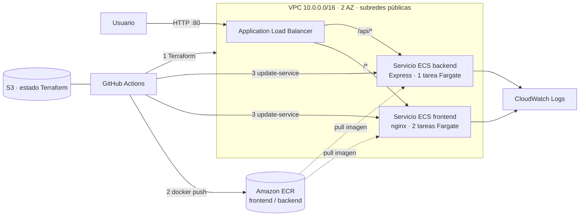

# Proyecto Final — Tres pipelines DevOps en AWS

Aplicación web **Tareas DevOps** (frontend nginx + backend Node/Express con API REST) desplegada en
**Amazon ECS Fargate**, con tres pipelines de **GitHub Actions**:

1. **Infraestructura** — Terraform aprovisiona VPC, seguridad, ALB, ECR y ECS.
2. **Build y publicación** — pruebas, construcción de imágenes Docker, tag por commit y push a ECR.
3. **Despliegue** — nueva task definition, actualización de servicios ECS, smoke test y rollback.

**Demo:** _(pega aquí el enlace al video o capturas de la demo)_

---

## Arquitectura



**Decisiones de arquitectura**

| Decisión | Motivo |
|---|---|
| Un solo ALB con regla `/api/*` → backend | Front y API comparten origen: sin CORS y una sola URL pública |
| Fargate en subredes públicas, sin NAT Gateway | Evita ~US$32/mes de NAT. El SG de las tareas **solo** acepta tráfico del ALB |
| Tag de imagen = SHA corto del commit (+ `latest`) | Trazabilidad: cada versión desplegada se corresponde con un commit; permite volver a cualquier versión |
| El servicio ECS ignora cambios de `task_definition` en Terraform | Terraform gestiona la infraestructura; el Pipeline 3 gestiona las versiones. Así no se pisan |
| Estado de Terraform en S3 con bloqueo nativo | Los runners son efímeros; el estado debe ser compartido y no admitir `apply` concurrentes |
| GitHub → AWS con **OIDC** (sin access keys) | No hay claves de larga duración que se puedan filtrar; cada ejecución recibe credenciales temporales de 1 h |
| Roles IAM de mínimo privilegio | El rol del CI solo gestiona roles `tareas-devops-*` y el bucket del estado; las tareas tienen su propio rol |
| Circuit breaker + smoke test + rollback | Una versión defectuosa nunca queda en producción |

## Estructura

```
terraform/      Infraestructura (.tf), variables de ejemplo, bootstrap del estado e instrucciones
aplicacion/     backend/ (Express + pruebas + Dockerfile), frontend/ (HTML/JS + nginx + Dockerfile), docker-compose.yml
pipelines/      Definiciones de los 3 pipelines y scripts (build-push, deploy-ecs, smoke-test)
.github/workflows/  Copia que ejecuta GitHub Actions
```

## Requisitos

- Cuenta AWS propia con un usuario administrador (solo para el paso 2), región `us-east-1`
- Cuenta de GitHub y Git
- Opcional para probar en local: Docker, Node 22, AWS CLI v2, Terraform ≥ 1.10

---

## Paso a paso para reproducir

### 0. (Opcional) Probar en local

```bash
cd aplicacion
docker compose up --build      # http://localhost:8080
```

### 1. Crear el repositorio en GitHub

Crea un repositorio **vacío** en GitHub (por ejemplo `EJGC18/proyecto-final-devops`) y prepara el local:

```bash
git init -b main
git add .
git commit -m "Proyecto final: tres pipelines DevOps en AWS"
git remote add origin https://github.com/<usuario>/<repo>.git
```

> Todavía **no** hagas `git push`: primero prepara AWS y GitHub (pasos 2 y 3).

### 2. Preparar la cuenta AWS (una sola vez)

En la consola de AWS cambia a la región **us-east-1** y abre **CloudShell** (icono `>_` arriba a la derecha).
Sube el archivo `terraform/bootstrap/preparar-cuenta.sh` (*Actions → Upload file*) y ejecuta,
con **tu** usuario/repositorio:

```bash
bash preparar-cuenta.sh <usuario>/<repo> us-east-1
```

El script crea:

| Recurso | Para qué |
|---|---|
| Bucket `tfstate-tareas-devops-<cuenta>` | Estado remoto de Terraform (versionado, cifrado, privado) |
| Proveedor OIDC `token.actions.githubusercontent.com` | Que AWS confíe en los tokens que emite GitHub |
| Rol `github-actions-tareas-devops` | Lo asumen los pipelines; **solo** tu repositorio puede usarlo |

Al final imprime los valores que necesitas en el paso 3.

> Si después cambias el nombre del repositorio, vuelve a ejecutar el script con el nombre nuevo.

### 3. Configurar GitHub (Settings → Secrets and variables → Actions → pestaña **Variables**)

| Variable | Valor | Obligatoria |
|---|---|---|
| `AWS_ROLE_ARN` | `arn:aws:iam::<cuenta>:role/github-actions-tareas-devops` (lo imprime el script) | Sí |
| `TF_STATE_BUCKET` | `tfstate-tareas-devops-<cuenta>` (lo imprime el script) | Sí |
| `AWS_REGION` | `us-east-1` | No (por defecto) |
| `PROJECT_NAME` | `tareas-devops` | No (por defecto) |

**No se crea ningún Secret**: con OIDC no hay claves de AWS que guardar.

### 4. Crear una alerta de costos (recomendado)

*Billing and Cost Management → Budgets → Create budget → Use a template → Monthly cost budget* con
US$5 y tu correo. Así te enteras si olvidas destruir la infraestructura.

### 5. Primer push → se ejecuta todo

```bash
git push -u origin main
```

En la pestaña **Actions** verás:

1. **1 - Infraestructura** → `terraform apply` (≈ 3-5 min). En el resumen aparece la `app_url`.
2. **2 - Build y publicación en ECR** → corre en paralelo; espera a que exista ECR, prueba, construye y publica.
3. **3 - Despliegue en ECS** → arranca solo al terminar el 2; despliega y hace el smoke test.

Abre la `app_url` (`http://tareas-devops-alb-....elb.amazonaws.com`). Deberías ver la app con la
versión del commit en *Frontend* y *Backend*, y el nombre de la tarea ECS que responde.


### 6. Ciclo normal de trabajo

- Cambias algo en `aplicacion/` → push → Pipeline 2 → Pipeline 3 automáticamente.
- Cambias algo en `terraform/` → push → Pipeline 1 (`apply`). Un PR solo hace `plan`.
- Volver a una versión anterior: *Actions → 3 - Despliegue en ECS → Run workflow* con el tag (SHA corto).

### 7. Al terminar: destruir todo

*Actions → 1 - Infraestructura → Run workflow* → `accion = destroy`, `confirmar_destroy = DESTRUIR`.
(El bucket del estado se borra a mano desde S3 si ya no lo necesitas.)

---

## Guion para la demo en vivo (≈ 10 min)

1. **Arquitectura** (este README): ALB, 2 servicios Fargate, ECR, por qué no hay NAT.
2. **Pipeline 1:** muestra la última ejecución (fmt → validate → plan → apply) y el resumen con outputs. En la consola: VPC, subredes, SGs, ALB y target groups *healthy*, cluster ECS.
3. **Cambio en vivo:** edita el título en `aplicacion/frontend/public/index.html`, commit y push.
4. **Pipeline 2:** pruebas → build en matriz → push. En la consola de **ECR** muestra la nueva imagen con tag = SHA y el escaneo de vulnerabilidades.
5. **Pipeline 3:** nueva revisión de task definition → rolling update → `services-stable` → smoke test. En **ECS** muestra la nueva revisión y los eventos del servicio.
6. **App:** recarga la URL; la versión mostrada coincide con el SHA del commit. Crea/marca/borra tareas (frontend ↔ API).
7. **Errores y credenciales:** muestra que en GitHub *Secrets* no hay nada (solo *Variables*) y en IAM el rol `github-actions-tareas-devops` con su política de confianza OIDC. Si hay tiempo, despliega manualmente un tag inexistente para mostrar que el Pipeline 3 lo rechaza sin tocar ECS.

## Manejo de errores

| Dónde | Mecanismo |
|---|---|
| Terraform | `fmt -check` + `validate` antes de planear; `apply` del plan exacto; bloqueo de estado; `concurrency` en el workflow; `destroy` con confirmación |
| Build | Si fallan las pruebas no se construye ni publica; `fail-fast` en la matriz |
| Despliegue | Verifica la imagen en ECR antes de desplegar; circuit breaker de ECS con rollback; espera de estabilidad; smoke test con reintentos; rollback explícito a la task definition anterior |
| App | Health checks en ALB (`/health`, `/api/health`) y en Docker; validación de entrada (400/404); cierre ordenado con `SIGTERM` |

## Manejo de credenciales

- **Sin claves de AWS en ningún lado.** GitHub Actions se autentica con **OIDC**: en cada ejecución GitHub emite un token firmado, AWS STS lo valida y entrega credenciales temporales (1 h) del rol `github-actions-tareas-devops`.
- **El rol solo confía en este repositorio** (condición `sub = repo:<usuario>/<repo>:*` y `aud = sts.amazonaws.com`). Un fork u otro repo no puede asumirlo.
- **Mínimo privilegio:** el rol del CI solo puede crear/borrar roles IAM con prefijo `tareas-devops-*` y leer/escribir el bucket del estado. Las tareas ECS usan su propio rol de ejecución (solo ECR + logs) y un rol de tarea sin permisos.
- **Nada sensible en el repositorio:** `.gitignore` excluye `terraform.tfvars`, `backend.hcl`, `.env`, `*.tfstate`, `.aws/`. Los valores en GitHub *Variables* (ARN del rol, nombre del bucket) no son secretos.
- El `GITHUB_TOKEN` tiene `contents: read` e `id-token: write` (solo lo necesario).
- Los contenedores no reciben claves y el backend corre como usuario no root.

## Solución de problemas

| Síntoma | Causa / solución |
|---|---|
| `Not authorized to perform sts:AssumeRoleWithWebIdentity` | El repo no coincide con el del script → ejecútalo otra vez con `<usuario>/<repo>` exacto |
| `Credentials could not be loaded` | Falta `id-token: write` o la variable `AWS_ROLE_ARN` |
| `AccessDenied` en IAM al hacer apply | Cambiaste `PROJECT_NAME`: los roles deben empezar con ese prefijo → vuelve a ejecutar el script con el proyecto nuevo (3er argumento) |
| `Falta la variable TF_STATE_BUCKET` | Crea la variable del paso 3 |
| `terraform fmt` falla | Ejecuta `terraform fmt -recursive` en local y haz commit |
| `Error acquiring the state lock` | Otra ejecución quedó cortada → `terraform force-unlock <ID>` en local |
| ALB devuelve **503** | Aún no hay tareas sanas: espera al Pipeline 3 o revisa *ECS → servicio → Eventos* |
| `CannotPullContainerError` | La imagen no existe en ECR o la tarea no tiene salida a Internet (IP pública) |
| Tareas se reinician en bucle | Revisa logs en CloudWatch: `/ecs/tareas-devops/backend` o `/frontend` |
| Las tareas creadas desaparecen | Es esperado: el backend guarda en memoria y se reinicia con cada despliegue |

## Costo aproximado

ALB (~US$0.03/h) + 3 tareas Fargate 0.25 vCPU/0.5 GB (~US$0.04/h en total) ≈ **US$0.07/h**.
Destruye la infraestructura después de la demo. El bucket del estado, el proveedor OIDC y el rol del CI no generan costo.
